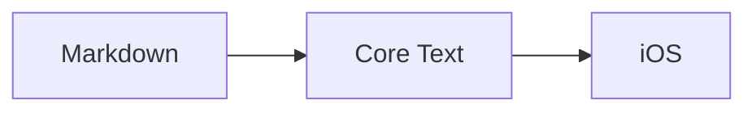

# Kasumi on iOS

This bundled fixture is rendered by **KasumiMarkdown** using Core Text, with *emphasis*, a [link](https://example.com), and `inline code`.

## Mathematics

Inline math: $E = mc^2$.

$$
\frac{a+b}{c} + \sqrt{x}
$$

## Diagram

## A small table

| Feature | Renderer |
| --- | --- |
| Text | Core Text |
| Math | Bundled fonts |
| Diagram | Native layout |

> The same library also renders on macOS.

End of the bundled fixture.
