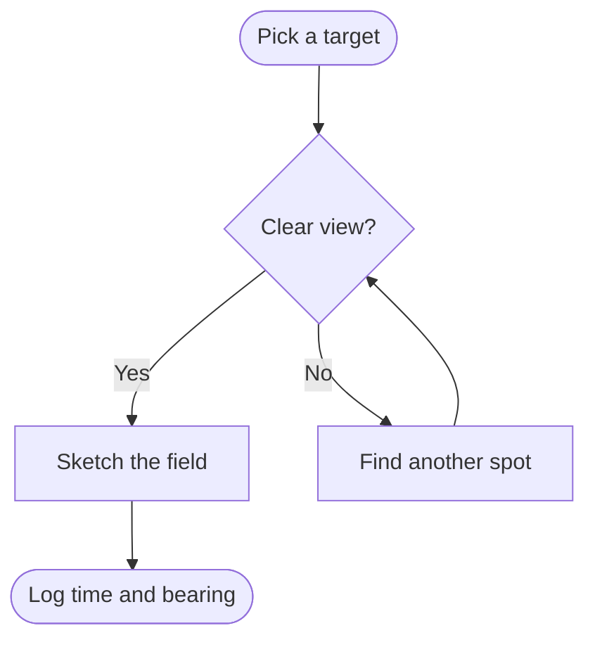

# Night Sky Field Notes

*An evening on the ridge · October 17*

By the time we reached the ridge, the last light was caught in the tops of the pines. We stayed on the path until our eyes adjusted. A star appeared over the western saddle, then a second; what had looked like a single dark slope slowly separated into trees, rock, and sky.

We chose the gap between two pines as our western marker. Through binoculars, the Moon’s unlit edge was just visible in earthshine. Instead of drawing the whole disk, I sketched the thin crescent and left the rest of the circle blank.

> Wait for the sky to get dark before deciding what you can see.

観察メモ：西の空に細い月が見えた。双眼鏡で見ると、地球照（earthshine）で月の暗い部分もかすかに見える。

## Measuring the Moon

Tonight’s first estimate was $\theta \approx 0.5^\circ$: about half a degree from one edge of the Moon to the other. For an object of diameter $d$ at distance $r$, its apparent width is

$$
\theta = 2\arctan\!\left(\frac{d}{2r}\right) \approx \frac{d}{r}.
$$

The approximation gives an angle in radians. A quick naked-eye estimate is enough to put the Moon, the stars of the Pleiades, and Orion’s Belt on the same scale.

| Target | Span | Look for |
| :--- | ---: | :--- |
| Moon | 0.5° | The unlit edge |
| Pleiades | 2° | A tight cluster |
| Orion’s Belt | 3° | Three bright stars |

## Planning a session

Pick a target that sits above the treeline, then sketch what you see before checking a chart.

<h2 align="center">Notes from the ridge</h2>

<em>West saddle &middot; 21:40 local time</em>

Conditions &amp; equipment

<strong>Sky:</strong> Clear to the west, with a thin cloud bank over the valley.

<strong>Binoculars:</strong> 7 &times; 50, braced against the trail marker.

<strong>Lens:</strong> Condensation (H2O) formed on the eyecups. <mark>Let them dry before packing.</mark>

For the next outing, check the <a href="https://science.nasa.gov/moon/moon-phases/">Moon’s phase</a> before leaving home.

