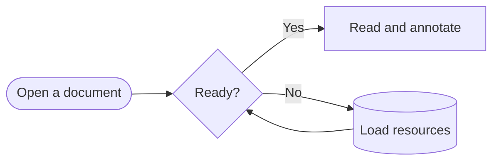
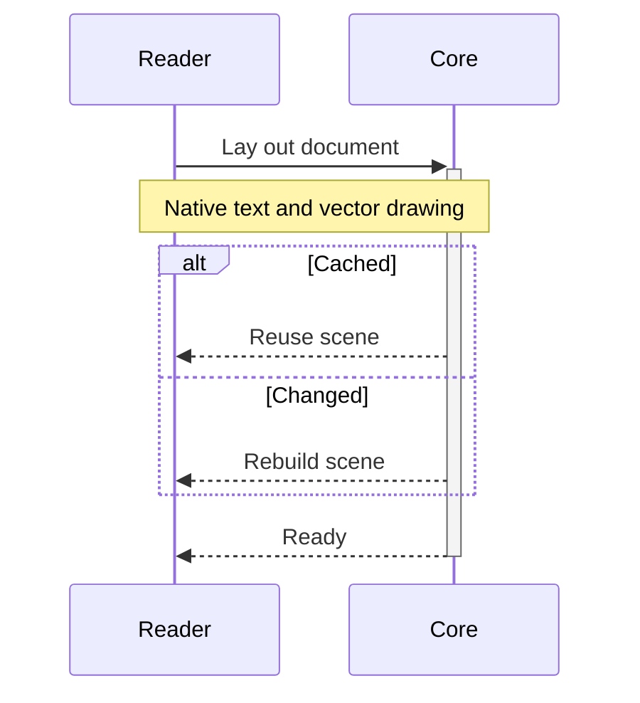
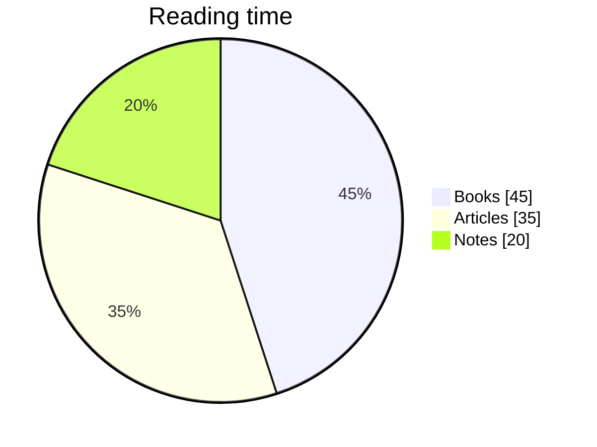
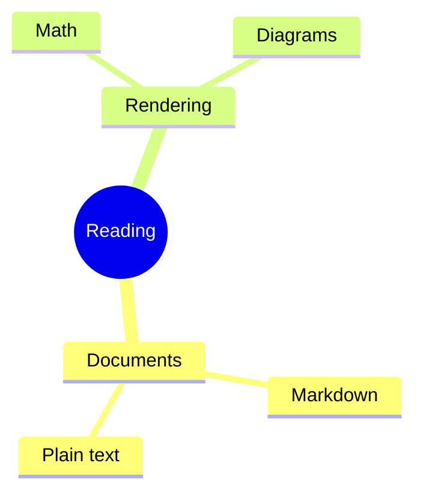
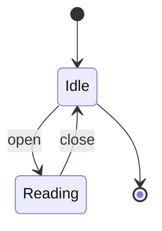
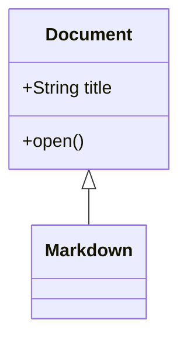
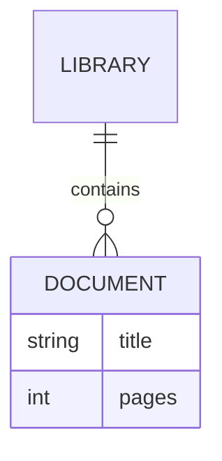
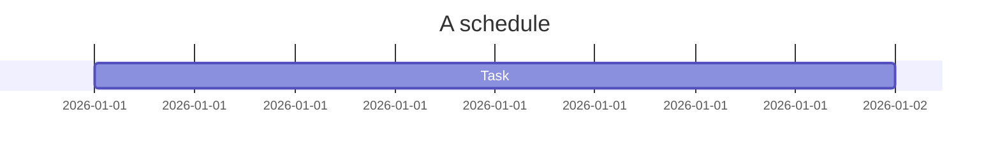

# Native diagrams

## Flowchart



## Sequence



## Pie



## Mindmap



## Tree


## State



## Class



## Entity relationships



## Unsupported syntax



## Invalid syntax

```mermaid
graph LR
  A[
```
