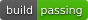

<picture><source media="(prefers-color-scheme: dark)" srcset="dark.svg"></picture>

<h1 align="center">HTML and SVG</h1>

  
  

A README-style sample for the Kasumi reader and exports.

Build from source

Press <kbd>⌘K</kbd> to <mark>search</mark>. Use <strong>bold</strong>, <em>italics</em>, <del>strike</del>, or <ins>underline</ins>. HTML scripts H2O and x2.

Markdown scripts H~2~O and x^2^. Run `make app` from ~/Projects.

## Links and entities

<a href="https://example.com/?a=1&amp;b=2">Example link</a> &middot; Japanese 日本語 &amp; 中文.

<!-- The HTML below falls back to text. -->
<table><tr><th>Platform</th><th>Minimum version</th></tr><tr><td>iOS</td><td>17</td></tr></table>
