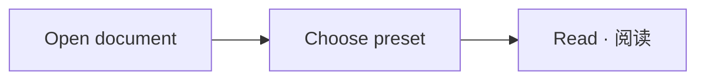

# Typography · 字体与排版

A reader should retain **strong text**, *emphasis*, ***both together***, [a link](https://example.com), ==a highlighted phrase== and `inline_code()` as the preset and theme change. 字体选择应保留**粗体中文**、*强调文字*与***组合强调***的层次。

This second paragraph makes spacing and first-line indentation visible. 宋体、楷体、黑体和等宽字体应与拉丁字符保持协调，切换预设后，段落应重新排版。

## Heading level two · 二级标题

### Heading level three · 三级标题

1. The first numbered item uses a shared marker column.
2. The second item wraps when its text reaches the edge of the reading column. 这段文字用于观察列表的换行与记号之间的距离。
   - A nested bullet.
   - Another nested bullet.

- A top-level bullet.
- A bullet with `inline code` and **strong text**.

> A quotation whose bar should cover every wrapped line. 引文的竖条与文字之间留有独立的间距，不能沿用列表记号的间距。 A sufficiently long quotation wraps naturally at a narrow reading width.

| Setting | Sample | Meaning |
| --- | --- | --- |
| Serif | 汉字 ABC | Mixed scripts |
| Code | `let value = 42` | Monospaced |
| Theme | ==Light and dark== | Document colors |

```swift
struct ReadingProfile {
    let name: String
    let baseline: Double
}
```



An equation keeps its native layout: $\frac{a+b}{c} + \sqrt{x^2+y^2}$. A footnote marker[^note] follows the chosen script size.

[^note]: Authored fixture; no personal document or original application asset is included.
