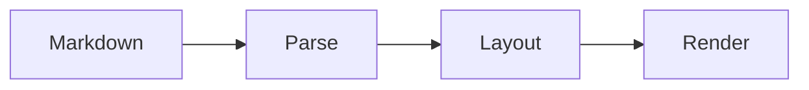

# Kasumi Rendering Reference

A **bold** introduction with *emphasis*, ~~strikethrough~~, `inline code`,
and [a local heading link](#tables-and-code).

中文排版测试：你好，世界！English and 中文 mixed typography.
日本語の文章と한국어 문장.

## Lists and quotation

- First item
- Second item
  - Nested item with **bold text**
- [ ] Pending task
- [x] Completed task

1. Ordered item
2. Another item

> A block quotation with a second paragraph.
>
> Another paragraph inside the quotation.

## Tables and code

| Feature | Status | Count |
| :--- | :---: | ---: |
| Markdown | Ready | 42 |
| 中文 | 检查 | 8 |

```swift
struct Greeting {
    let message = "Hello, Kasumi"
    func render() { print(message) }
}
```

## Mathematics

Inline math: $E = mc^2$.

$$
\int_0^1 x^2\,dx = \frac{1}{3}
$$

## Diagrams



## Notes

A sentence with a footnote.[^note]

[^note]: Footnote content with **formatting**.

---

Last paragraph for navigation, search, selection, copy, and export checks.
